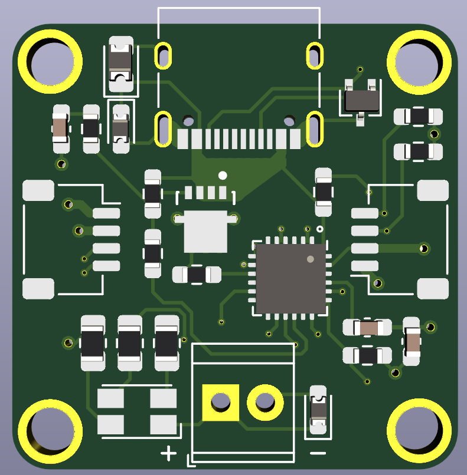

# STUSB4500 USB Power Delivery breakout

A KiCad design for a USB-C Power Delivery sink board built around the STMicroelectronics STUSB4500, with STEMMA QT I²C connectors, screw-terminal power output, and an RGB voltage indicator.

## Status

This is a hobbyist hardware project started in October 2020. The design history includes manufacturing preparation, and fabrication exports are included. The repository description has historically marked the project as work in progress; it does not record electrical validation results or a confirmed production revision.

**Do not use the current source or included Gerbers/drill files for manufacture until the circuit issues are resolved.** A [source audit](docs/code-audit-report.md) found VREG_2V7 tied to the host supply rail and an RGB indicator path from the negotiated supply to a low-voltage controller output. Those circuits require correction and review; the historical exports are not a validated release.

## Features

* Control the STUSB4500 over I²C from a compatible STEMMA QT host, such as an Adafruit board or a SparkFun Qwiic board.
* Configure up to three USB-C PD sink profiles, supported by the [STUSB4500 controller](https://www.st.com/resource/en/datasheet/stusb4500.pdf). This repository does not provide configuration software or a verified board setup procedure.
* Connect downstream devices to the screw terminals.
* Indicate the selected voltage with the RGB LED; the repository does not document a verified colour-to-voltage mapping.
* Four-layer PCB with two STEMMA QT connectors and mounting holes.

## Design files

* [KiCad project](STUSB4500_Breakout.pro), [schematic source](STUSB4500_Breakout.sch), and [PCB layout](STUSB4500_Breakout.kicad_pcb).
* [Schematic PDF](STUSB4500_Breakout.pdf) for viewing without KiCad, and [netlist](STUSB4500_Breakout.net).
* [Gerber and plated/non-plated drill exports](gerber/) for fabrication review.
* [PCB image](images/pcb1.png) and [second 3D view](images/3d2.png).
* [Component and reference-design documents](docs/).
* [Cached historical symbols](STUSB4500_Breakout-cache.lib) and project [symbol](sym-lib-table)/[footprint](fp-lib-table) tables for reproducible library setup.

There is no standalone bill of materials, host firmware, or STUSB4500 configuration tool in this repository. Component values and footprints are recorded in the schematic.

## Open or modify the design

1. Clone this repository, then open `STUSB4500_Breakout.pro` in KiCad. The PCB records KiCad **5.1.7**, and the schematic uses the legacy `.sch` format. Work on a copy when importing into a newer KiCad version.
2. Install the corresponding KiCad standard symbol, footprint, and 3D-model libraries.
3. Clone [Makeristic-KiCad-Library](https://github.com/makeristic/Makeristic-KiCad-Library) alongside this repository. The project tables resolve its legacy symbols and `.pretty` footprints under the nickname `Makeristic-KiCad-Library` from that sibling directory. The design references its MOSFET, mounting-hole, and STEMMA QT logo assets. Keep the committed symbol cache with the schematic; it preserves historical symbol geometry and pin mapping.
4. Resolve missing-library warnings before editing, then review the schematic, PCB, design rules, and fabrication outputs together. Included exports are historical snapshots and have not been regenerated as part of this documentation update.

## Feedback and related projects

Use [Issues](https://github.com/makeristic/STUSB4500_Breakout/issues) for questions, build reports, or design corrections. Include the commit, KiCad version, and relevant schematic references; for pull requests, explain electrical changes and which exports you regenerated.

See also the [Feather STM32WB55 board](https://github.com/makeristic/Feather_STM32WB55) and the [Makeristic repository collection](https://github.com/orgs/makeristic/repositories).

## Licence

The original work in this repository remains licensed under [Creative Commons Attribution 4.0 International](https://creativecommons.org/licenses/by/4.0/), as specified by the original README. See [LICENSE](LICENSE) for the full licence text. Attribute Michael Cutler / Makeristic and link to this repository when reusing the original design.

Vendor documents in `docs/`, third-party library elements embedded in the design, cached KiCad symbols, and third-party marks remain subject to their respective owners' terms; the project licence does not relicense those materials. KiCad symbols retain [CC BY-SA 4.0 with the KiCad exception](LICENSES/KiCad-Libraries.md); the [audit](docs/code-audit-report.md) records their source version and provenance.

